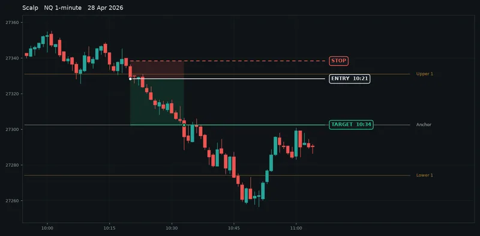
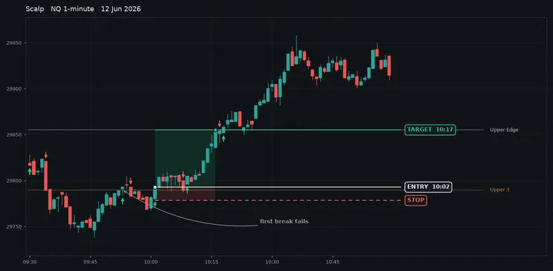
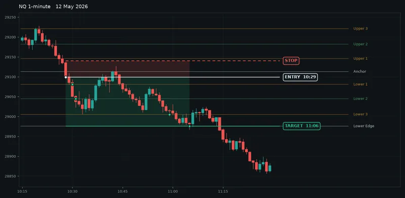
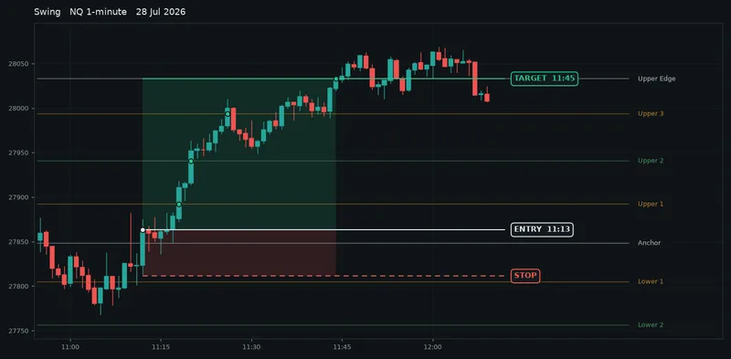

# HunterStrike playbook: how to trade the levels

This is how to read the ladder, how to scalp it, how to swing it, and how to turn a plain break into an A+ setup.

[Back to the README](README.md). The canonical version of this page is at [huntersalgo.com/indicators/hunterstrike/playbook](https://huntersalgo.com/indicators/hunterstrike/playbook).

The charts on this page are real NQ 1-minute bars with the levels and arrows the indicator draws. I chose the days to show each pattern clearly, and the point figures are level to level, not filled trades. They are examples of what the indicator draws, not a performance record.

## Contents

- [Reading the ladder](#reading-the-ladder)
- [The rule set](#the-rule-set)
- [Scalps](#scalps)
- [Swing trades](#swing-trades)
- [When not to trade](#when-not-to-trade)
- [Adding confluence for A+ setups](#adding-confluence-for-a-setups)
- [Session checklist](#session-checklist)

## Reading the ladder

Nine levels are set from the New York pre-market and held for the rest of the day. They scale with the session, so a quiet morning gives a tight ladder and a busy one gives room to run.

| Level | What it is |
| --- | --- |
| Upper Edge, Lower Edge | The two ends of the ladder. Swing targets. |
| Upper 3, Lower 3 | Last rung before an edge. Often where a move stalls first. |
| Upper 2, Lower 2 | Mid rungs. The most-traded scalp targets. |
| Upper 1, Lower 1 | Inner rungs either side of the Anchor. First scalp target after an Anchor break. |
| Anchor | Where the ladder is pinned. Bias line for the whole session. |

**Arrows.** A green arrow under a bar means it closed above a level after the previous bar closed below it. A red arrow above a bar is the mirror. Wicks through a level are ignored, only closes count, and a bar that clears two rungs gets two arrows.

**Any instrument.** The levels are built from the day's own range, not fixed point distances, so it works the same on NQ, ES, gold, crude, currencies or a stock. Every chart here is NQ on 1-minute bars because that is where the examples came from. The rules do not change on a 3-minute or 5-minute chart, the moves just take longer.

## The rule set

| Rule | What to do |
| --- | --- |
| Trigger | A bar closes through a level and prints an arrow. That is the only entry signal. Enter on the close of the arrow bar or the open of the next one. |
| Stop | Behind the level you broke, plus a buffer. If price closes back through the level against you, you are wrong and the stop should already be gone. |
| Target | The next rung in your direction. Scalps take it. Swings take a piece there and trail the rest rung by rung. |
| Time | Nothing before the open. The first arrows of the day are noise from the gap. Best trades come from 09:45 to 12:00 and again into the afternoon. Nothing new after 15:30. |
| Bias | Above the Anchor, favour longs. Below it, favour shorts. Counter-bias trades need extra confluence. |
| Skip | If the same level prints arrows both ways three times, the market is choosing not to move. Stand down on that level for the rest of the session. |

## Scalps

A scalp is one rung. Enter on the break, target the next level, done. On NQ that is typically 25 to 40 points on a normal day, so roughly $500 to $800 a contract, or $50 to $80 on the MNQ micro. Those figures are the distance from one level to the next, not filled trades. The trade is over in ten to twenty minutes and you take the target in full.

Scalp short, NQ, 28 April 2026. Price sat above Upper 1 all morning, then a bar closed under it at 10:21. Stop just above the level. The Anchor was reached 13 minutes later: 25.75 points, $515 on one NQ contract or $51 on one MNQ micro. Rendered from real NQ 1-minute bars. The figure is level to level, not a filled trade.

Scalp long, NQ, 12 June 2026. The first close above Upper 3 at 09:54 failed and price dropped straight back under. The second break at 10:02 held, and the Upper Edge was reached fifteen minutes later: 62.25 points, $1,245 on one NQ contract or $124 on one MNQ micro. Rendered from real NQ 1-minute bars. The figure is level to level, not a filled trade.

Taking the second break rather than the first is the single most useful habit in this playbook.

**Scalp checklist**

- Price has been on one side of the level for at least fifteen minutes.
- The arrow bar closes clearly through, not by one tick.
- The next rung is far enough away that the reward covers the stop.
- You are trading with the Anchor bias, or you have two confluences from the list below.

## Swing trades

A swing is the whole ladder. It is the same entry, but you hold for the far edge, taking a piece at each rung and moving the stop up behind the last rung cleared. Two or three of these a week pay for a lot of scalps.

Swing short, NQ, 12 May 2026. The open dumped through the top of the ladder, bounced back, then broke the Anchor a second time at 10:29. From there every rung fell in turn to the Lower Edge, 123 points below the entry: $2,460 on one NQ or $246 on one MNQ. The bounce at 10:39 never closed back above the Anchor, so the position stayed on. Rendered from real NQ 1-minute bars. The figure is level to level, not a filled trade.

Swing long, NQ, 28 July 2026. The morning sold off below the Lower Edge, then price climbed back and reclaimed the Anchor at 11:13, the second time that day. What followed was the whole upper ladder in about half an hour, 169.5 points to the Upper Edge: $3,390 on one NQ or $339 on one MNQ. Rendered from real NQ 1-minute bars. The figure is level to level, not a filled trade.

**Swing checklist**

Same trigger as a scalp, plus one of:

- price reclaiming the Anchor after being on the other side
- a level breaking on the second attempt
- the higher timeframe pointing the same way

Take a third off at each rung, move the stop behind each rung cleared, and let the last third run to the edge.

## When not to trade

A no-trade day shows arrows both ways on every rung and nothing follows through. The tell is visible early: three arrows in each direction on the same level. Close the chart.

- **Tight ladder.** If the rungs are closer together than your normal stop distance, the ladder cannot pay. Skip the day, or drop to MNQ so the smaller move still covers the cost of trading.
- **News at 10:00 or 10:30.** The first break after a data release is a coin flip. Wait for the second.
- **Lunch.** From 12:00 to 13:30, breaks fail more than they hold. Scalps only, if at all.

## Adding confluence for A+ setups

A bare arrow is a B setup. The indicator tells you where, not whether. Each item below is something a break can line up with. Two of them turns a B into an A. Three is an A+.

### Higher timeframe agrees

The 15-minute or hourly trend points the same way as the break. A long above the Anchor inside a rising hourly is a trade. The same long inside a falling hourly is a fade.

### Second break, not first

The first close through a level fails often. When it fails, the second break through the same level has the trapped traders on the wrong side, and they are your fuel.

### Anchor reclaim

Price spent time on the other side of the Anchor, then closes back through it. Both swing examples above started this way. It is the strongest trigger on the ladder.

### Prior day high or low

When a rung sits within a few points of yesterday's high, low or close, the level has two reasons to matter. Breaks through those rungs travel further.

### VWAP on the same side

Long above VWAP, short below. A break that also clears VWAP in the same bar is a clean trigger. A break that leaves VWAP behind you is a warning.

### Volume on the arrow bar

The arrow bar prints more volume than the bars around it. A break on thin volume is a drift, not a decision.

### Structure break

The arrow bar also takes out the last swing high or low on the 1-minute chart. Level and structure breaking together is the classic A+ shape.

### Wide range day

Rungs 30 points or more apart on NQ. The move has room to pay and the stop is small relative to the target.

### Grading a setup

Count what is true at the moment of the arrow.

| Count | What to do |
| --- | --- |
| One or none | Skip it, or take a quarter size scalp. |
| Two | Normal size, next rung target. |
| Three or more | Full size, swing management, trail rung by rung. |

## Session checklist

- Chart loaded with the indicator, Levels on Normal, before the open.
- Ladder height noted. Rungs closer together than your normal stop is a caution day.
- Anchor marked as the bias line. Above it longs, below it shorts.
- Yesterday's high, low and close checked against the rungs.
- News times written down. No first breaks inside five minutes of them.
- Daily loss limit set. Two full stops and the session is over.

## Getting HunterStrike

HunterStrike comes with every HuntersAlgo plan. Every plan covers all strategies and all indicators on one licence email. Plans are at [huntersalgo.com/pricing](https://huntersalgo.com/pricing).

---

Mirrored from huntersalgo.com on 30 September 2026. The site is the canonical version.

HunterStrike draws levels and marks breaks. It does not place trades. Chart examples are rendered from historical data and are not a record of live results. Futures trading involves substantial risk of loss and is not suitable for every investor. Past performance is not indicative of future results. HuntersAlgo sells software and does not provide financial advice.

NinjaTrader® is a registered trademark of NinjaTrader Group, LLC. No NinjaTrader company has any affiliation with the owner, developer, or provider of the products or services described herein, or any interest, ownership or otherwise, in any such product or service, or endorses, recommends or approves any such product or service.
