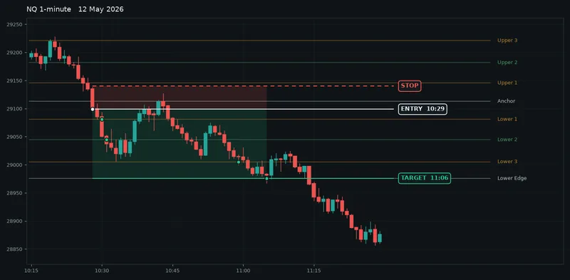
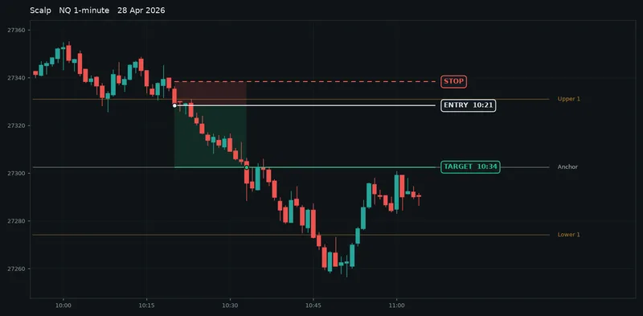
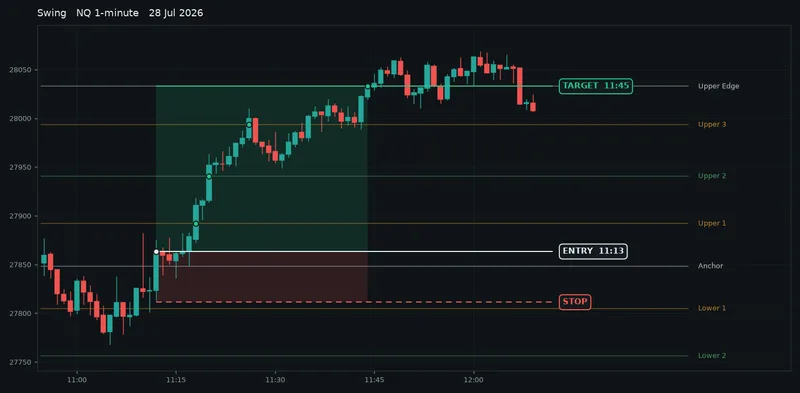
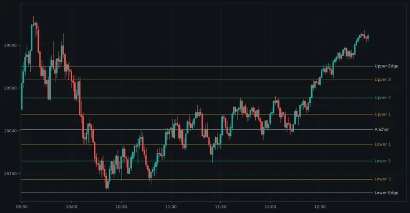
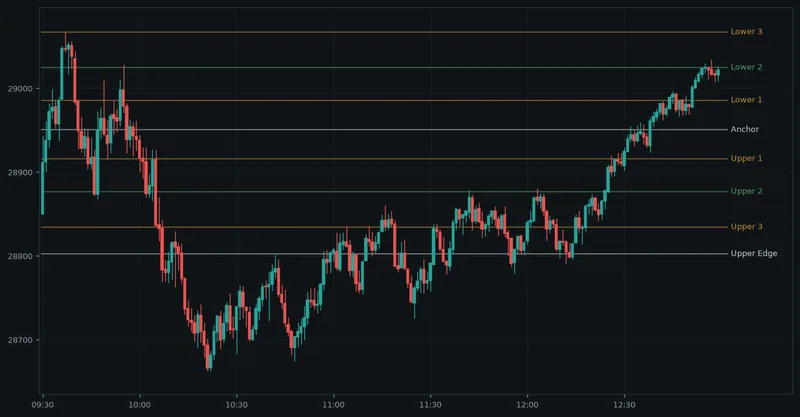

# HunterStrike

HunterStrike is an indicator for NinjaTrader 8. It draws a ladder of nine intraday levels set from the New York pre-market and held all session, and it puts an arrow on every bar that closes through one.

It does not place trades. It draws the levels and marks the breaks. You trade them by hand, or with your own strategy.

This repo is a mirror of the public HunterStrike page and its playbook on [huntersalgo.com](https://huntersalgo.com/indicators/hunterstrike). It holds the write-up and the chart examples. It does not hold the indicator.

NQ, 12 May 2026. Entry on the Anchor break at 10:29, stop above it, then every lower rung in turn to the Lower Edge: 123 points, which is $2,460 on one NQ contract or $246 on one MNQ micro. Rendered from real bars, not a live screenshot.

## What it draws

### Nine levels, set before the open

The levels are drawn from the New York pre-market and held for the whole session. They scale with the day, so a quiet morning gives a tight ladder and a busy one gives room to run.

### Arrows on real breaks

A bar that closes through a level gets an arrow. Wicks do not count. It is one arrow per level, so a single bar can earn two.

### One decision

Normal or Flipped. There are no windows to type and no numbers to tune. Every user reads the same lines, whether they trade NQ or the MNQ micro. Colours and visibility are yours to set.

## The ladder

The Anchor is the bias line: longs above it, shorts below. The rungs either side are targets, and the edges are where swings aim.

| Level | Role |
| --- | --- |
| Upper Edge | Swing target |
| Upper 3 | Stall zone |
| Upper 2 | Scalp target |
| Upper 1 | First rung |
| Anchor | Bias line |
| Lower 1 | First rung |
| Lower 2 | Scalp target |
| Lower 3 | Stall zone |
| Lower Edge | Swing target |

Scalps run one rung. Swings run the ladder.

## Two ways to trade it

The trigger is the same. The hold is different.

Scalp. NQ, 28 April 2026. Entry on the close under Upper 1, stop just above it, Anchor reached 13 minutes later. One rung, 25.75 points: $515 on one NQ, $51 on one MNQ. Rendered from historical data, not a record of live results.

Swing. NQ, 28 July 2026. Entry on the Anchor reclaim at 11:13, a piece off at every rung, the last of it at the Upper Edge half an hour later. 169.5 points: $3,390 on one NQ, $339 on one MNQ. Rendered from historical data, not a record of live results.

## Normal or Flipped

This is the one decision.

Normal. NQ, 19 May 2026. Rendered from historical data.

Flipped. NQ, 19 May 2026. Same bars, same session, the ladder read the other way: the Anchor moves and the rungs count in the opposite direction. Rendered from historical data.

Leave it on Normal unless you want to read the day against the pre-market lean.

## Up and running in three steps

1. **Install.** Import the HuntersAlgo package once. HunterStrike appears in your indicator list next to the strategies.
2. **Add to a chart.** Any instrument, any bar size. Enter your licence email and leave Levels on Normal.
3. **Wait for the open.** The ladder appears as the New York session starts. Trade the arrows by the playbook.

## Questions

**Does it work outside NQ?**

Yes. The levels come from each instrument's own pre-market, so it behaves the same on ES, gold, crude, currencies or a stock.

**Which bar size should I use?**

One to five minute bars are the sweet spot. On higher timeframes the arrows come late.

**Can I change the levels?**

Not where they sit. The ladder is fixed so every user reads the same lines, and the one decision is Normal or Flipped. Colours, line styles and which levels are drawn are yours to change in the indicator settings.

**Does it place trades?**

No. HunterStrike draws levels and marks the breaks. You trade them by hand, or with your own strategy.

## The playbook

[PLAYBOOK.md](PLAYBOOK.md) is how I trade the levels. It covers scalps and swings with real chart examples, the days to skip, and the confluences that turn a plain break into an A+ setup.

The same playbook is on the site at [huntersalgo.com/indicators/hunterstrike/playbook](https://huntersalgo.com/indicators/hunterstrike/playbook).

## How to get it

HunterStrike is included in every HuntersAlgo plan alongside the strategies. It uses the same login and the same licence email, at no extra charge. Every plan covers all strategies and all indicators, and there is a free trial you can cancel any time.

Plans are at [huntersalgo.com/pricing](https://huntersalgo.com/pricing). The indicator page is at [huntersalgo.com/indicators/hunterstrike](https://huntersalgo.com/indicators/hunterstrike).

---

Mirrored from huntersalgo.com on 30 September 2026. The site is the canonical version.

HunterStrike draws levels and marks breaks. It does not place trades. Chart examples are rendered from historical data and are not a record of live results. Futures trading involves substantial risk of loss and is not suitable for every investor. Past performance is not indicative of future results. HuntersAlgo sells software and does not provide financial advice.

NinjaTrader® is a registered trademark of NinjaTrader Group, LLC. No NinjaTrader company has any affiliation with the owner, developer, or provider of the products or services described herein, or any interest, ownership or otherwise, in any such product or service, or endorses, recommends or approves any such product or service.
